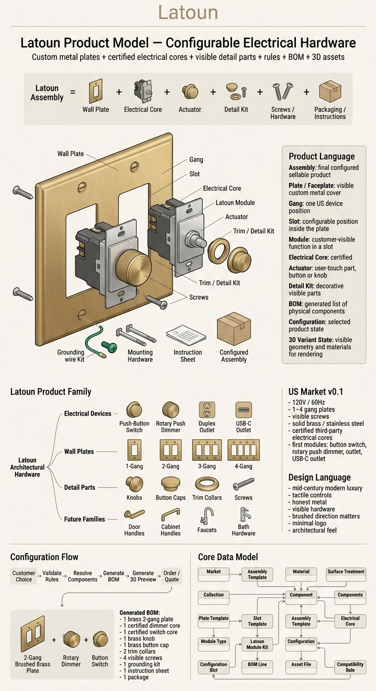

# Latoun Product Model — Configurable Architectural Electrical Hardware

Latoun is a mid-century modern luxury architectural hardware brand focused first on configurable electrical devices for the US market: light switches, rotary dimmers, outlets, and USB-C outlets. The long-term brand direction can expand into related metal hardware categories such as door handles, cabinet handles, faucets, and bath hardware.

The first product line is a configurable wall-device system built from real metal plates, visible screws, tactile controls, and certified third-party electrical cores. The customer-facing product should feel simple: choose a plate, choose modules, choose material/surface treatment, preview the product, and generate an order.

Internally, the product is more like a small vehicle configurator than a simple e-commerce SKU. A final Latoun product is not one fixed object. It is a resolved configuration assembled from parts, rules, electrical cores, visible detail pieces, 3D assets, pricing data, and BOM logic.

This project defines the **Latoun Product Model**, or **LPM**:

> LPM is the data model and configuration system that describes Latoun products, validates allowed combinations, generates BOMs, calculates prices, connects to 3D assets, and supports future sales/manufacturing workflows.

The goal of this repository is to build the documentation, database, local web configurator, front end, back end, and 3D data pipeline needed to support Latoun’s first product family.

---

# 1. Product Summary

Latoun’s first product category:

```text
Latoun US Wall Device Assembly
```

A Latoun wall device assembly is a complete sellable electrical hardware product.

Example customer-facing products:

```text
Latoun MCM 1-Gang Brass Button Switch
Latoun MCM 1-Gang Brass Rotary Dimmer
Latoun MCM 2-Gang Brass Rotary Dimmer + Button Switch
Latoun MCM 1-Gang Stainless Steel Duplex Outlet
Latoun MCM 1-Gang Brass USB-C Outlet
```

The assembly is built from:

```text
Latoun Assembly
=
custom metal wall plate
+ certified third-party electrical core
+ Latoun actuator
+ visible screws
+ grounding/mounting hardware
+ packaging
+ installation instructions
```

Latoun plans to sell complete electrical devices, but the first version should use existing certified third-party internal electrical modules. Latoun owns the visible product language: metal plate, knobs, buttons, visible screws, surface treatment, packaging, configurator, BOM, and brand experience.

Important design principle:

```text
Customer-facing simplicity.
Internal modularity.
```

The user should see a premium product. The database should see a configurable assembly.

---

# 2. Current Product Direction

## 2.1 Market

Initial market:

```text
US only
```

The data model should still include a `market` entity so that future EU/UK expansion does not require a full redesign.

US electrical context:

```text
Nominal voltage: 120V
Frequency: 60Hz
Wall device format: US gang-based wall boxes
Initial gang sizes: 1-gang, 2-gang, 3-gang, 4-gang
MVP gang sizes: 1-gang and 2-gang first
```

## 2.2 Brand Direction

Latoun should feel like:

```text
mid-century modern luxury
architectural hardware
honest metal
tactile
warm
technical
premium
not flashy
```

Visual traits:

```text
solid brass
stainless steel
visible screws
small button switch
rotary push dimmer
clean plate geometry
subtle logo
brushed metal direction matters
simple repeated hardware language
```

## 2.3 First Product Modules

Initial module types:

```text
push_button_switch
rotary_push_dimmer
duplex_outlet
usb_c_outlet
blank
```

Customer-facing module names:

```text
Button Switch
Rotary Dimmer
Outlet
USB-C Outlet
Blank
```

Technical names:

```text
maintained push-button switch
rotary dimmer with push on/off
duplex receptacle
USB-C receptacle / USB-C power outlet
blank filler module
```

## 2.4 Materials

Latoun should use actual metal, not fake metal-colored finishes.

Initial material candidates:

```text
solid_brass
stainless_steel
```

Avoid using plain non-stainless steel for luxury interior products unless there is a specific finish/protection strategy, because plain steel can rust.

## 2.5 Surface Treatments

Because the product uses real metal, the model should distinguish **material** from **surface treatment**.

Examples:

```text
solid brass + brushed
solid brass + polished
solid brass + aged
stainless steel + brushed
stainless steel + polished
```

Do not model “brass” as a surface finish if the plate is actually made of solid brass.

---

# 3. Core Product Language

Use these terms consistently across code, UI, documentation, database, and 3D assets.

| Term | Meaning |
|---|---|
| **Brand** | Latoun. |
| **Market** | Sales/electrical region, initially US. |
| **Collection** | Design family, for example `MCM Luxury`. |
| **Assembly** | Final configured sellable product. |
| **Wall Plate / Faceplate** | Visible custom metal cover mounted on the wall. |
| **Gang** | One US wall-device position. A 2-gang plate has two device positions. |
| **Slot** | Configurable position inside a plate. Slot 1, Slot 2, etc. |
| **Module Type** | Functional type placed into a slot: switch, dimmer, outlet, USB-C outlet. |
| **Electrical Core** | Certified third-party internal electrical device. |
| **Latoun Module Kit** | Combination of electrical core plus Latoun visible parts needed to create one module. |
| **Actuator** | User-touch part: button cap, dimmer knob, outlet face, etc. |
| **Hardware Kit** | Screws, spacers, grounding hardware, mounting pieces. |
| **Configuration** | Customer-selected product state. |
| **Resolved BOM** | Generated list of physical parts needed to build a configuration. |
| **3D Variant State** | Geometry/material state used to preview or render the configuration. |
| **SKU** | Stock keeping unit, usually for physical components rather than every possible final configuration. |

---

# 4. Product Hierarchy

The top-level product hierarchy should be broader than electrical switches, because Latoun may later expand into handles, faucets, and other hardware.

```text
Latoun
└── Architectural Hardware
    ├── Electrical Devices
    │   ├── Wall Device Assemblies
    │   │   ├── Button Switch Assembly
    │   │   ├── Rotary Dimmer Assembly
    │   │   ├── Duplex Outlet Assembly
    │   │   └── USB-C Outlet Assembly
    │   ├── Wall Plates
    │   │   ├── 1-Gang Plate
    │   │   ├── 2-Gang Plate
    │   │   ├── 3-Gang Plate
    │   │   └── 4-Gang Plate
    │   └── Detail Parts
    │       ├── Knobs
    │       ├── Button Caps
    │       └── Screws
    ├── Door Hardware
    ├── Cabinet Hardware
    ├── Faucets
    └── Bath Hardware
```

For MVP, only implement:

```text
Architectural Hardware
└── Electrical Devices
    └── Wall Device Assemblies
```

---

# 5. Key Modeling Principle

Do **not** create one permanent SKU for every possible final configuration.

Bad model:

```text
LAT-2G-BRASS-DIMMER-SWITCH-BRASS-KNOB-BRASS-SCREWS
LAT-2G-BRASS-DIMMER-OUTLET-BRASS-KNOB-BRASS-SCREWS
LAT-2G-STEEL-DIMMER-OUTLET-STEEL-KNOB-STEEL-SCREWS
...
```

This explodes quickly.

Correct model:

```text
Stock components.
Configure assemblies.
Generate BOMs.
```

The inventory system should track physical parts:

```text
plate
electrical core
knob
button cap
screw
hardware kit
packaging
instruction sheet
```

The customer order should contain a configured assembly that references those components.

---

# 6. Example Configuration

Example customer configuration:

```json
{
  "brand": "Latoun",
  "market": "US",
  "collection": "mcm_luxury",
  "assembly_type": "wall_device_assembly",
  "plate": {
    "gang_count": 2,
    "material": "solid_brass",
    "surface_treatment": "brushed",
    "screw_style": "visible"
  },
  "slots": [
    {
      "position": 1,
      "module_type": "rotary_push_dimmer",
      "electrical_core_sku": "CORE-DIM-ROT-PUSH-001",
      "actuator": "round_knurled_knob",
      "detail_material": "solid_brass",
      "detail_surface_treatment": "brushed"
    },
    {
      "position": 2,
      "module_type": "push_button_switch",
      "electrical_core_sku": "CORE-SW-PBTN-SP-001",
      "actuator": "small_round_button",
      "detail_material": "solid_brass",
      "detail_surface_treatment": "brushed"
    }
  ]
}
```

Generated BOM:

```json
[
  {
    "component_sku": "LAT-PL-US-MCM-2G-BRS-BRU",
    "display_name": "Latoun MCM 2-Gang Brushed Brass Plate",
    "quantity": 1,
    "source": "plate"
  },
  {
    "component_sku": "CORE-DIM-ROT-PUSH-001",
    "display_name": "Certified Rotary Push Dimmer Core",
    "quantity": 1,
    "source": "slot_1_electrical_core"
  },
  {
    "component_sku": "CORE-SW-PBTN-SP-001",
    "display_name": "Certified Push Button Switch Core",
    "quantity": 1,
    "source": "slot_2_electrical_core"
  },
  {
    "component_sku": "LAT-KNB-US-MCM-BRS-BRU",
    "display_name": "Latoun Brushed Brass Dimmer Knob",
    "quantity": 1,
    "source": "slot_1_detail"
  },
  {
    "component_sku": "LAT-BTN-US-MCM-BRS-BRU",
    "display_name": "Latoun Brushed Brass Button Cap",
    "quantity": 1,
    "source": "slot_2_detail"
  },
  {
    "component_sku": "LAT-SCR-US-MCM-BRS-BRU",
    "display_name": "Latoun Brushed Brass Visible Screw",
    "quantity": 4,
    "source": "hardware"
  },
  {
    "component_sku": "LAT-HWK-US-2G",
    "display_name": "Latoun 2-Gang Hardware Kit",
    "quantity": 1,
    "source": "hardware"
  },
  {
    "component_sku": "LAT-INS-US-DIM-SW",
    "display_name": "Dimmer + Switch Installation Sheet",
    "quantity": 1,
    "source": "instructions"
  },
  {
    "component_sku": "LAT-PKG-US-2G",
    "display_name": "Latoun 2-Gang Packaging",
    "quantity": 1,
    "source": "packaging"
  }
]
```

---

# 7. MVP Scope

Build the first version around a small but real catalog.

## 7.1 MVP Product Scope

```text
Market:
US

Collection:
MCM Luxury

Gang sizes:
1-gang
2-gang

Materials:
solid brass
stainless steel

Surface treatments:
brushed
polished

Modules:
push-button switch
rotary push dimmer
duplex outlet
USB-C outlet
blank

Hardware:
visible screws
matching metal detail parts

Outputs:
BOM
price
3D preview
saved configuration
```

## 7.2 Not in MVP

Do not implement these in the first version unless explicitly needed:

```text
checkout
payment
shipping integration
user accounts
contractor portal
multi-warehouse inventory
ERP integration
real certification workflow
complex admin permissions
Unreal Engine web streaming
```

Keep the first version local and simple.

---

# 8. Recommended Technology Stack

## 8.1 Local MVP

```text
Frontend:
React
TypeScript
Three.js or React Three Fiber

Backend:
FastAPI
Pydantic
SQLAlchemy

Database:
SQLite

3D:
Houdini master scene
USD for internal/master structure
GLB/glTF for web preview

Runtime:
Local Windows PC first
Docker later
```

## 8.2 Future Deployment

```text
Prototype/demo:
Hugging Face Spaces with Docker

Production:
VPS or cloud server
PostgreSQL
object storage for assets
proper auth
admin interface
backup strategy
```

## 8.3 Unreal Engine

Do not use Unreal Engine for the first browser configurator. It is too heavy for a small product preview.

Use Unreal later for:

```text
marketing renders
cinematic product shots
high-end showroom visualization
internal design review
```

For the local/public web configurator, use Three.js/WebGL.

---

# 9. Application Goals

The local configurator should allow the user to:

```text
choose market
choose collection
choose plate size
choose material
choose surface treatment
choose module per slot
validate the configuration
generate BOM
calculate price
preview in 3D
save configuration
export configuration as JSON
export BOM as JSON or CSV
```

The coding agent should build the system so that product knowledge lives in the database/rules, not hardcoded in UI components.

---

# 10. Configuration Flow

The user-facing UI can be simple:

```text
1. Choose plate size
2. Choose plate material
3. Choose plate surface treatment
4. Choose module for each slot
5. Choose detail material/surface treatment
6. Validate
7. Show BOM
8. Show price
9. Show 3D preview
10. Save/export configuration
```

Internal flow:

```text
Customer selections
    ↓
Validation rules
    ↓
Resolved configuration
    ↓
Generated BOM
    ↓
Generated price
    ↓
Generated 3D variant state
    ↓
Order / quote / render
```

---

# 11. Rules and Validation

Use a constraint/rule system, not a hardcoded state machine.

A state machine can guide the UI steps. The actual product validity should be rule-based.

Example rules:

```text
A 2-gang plate must have two slot configurations.
A module must fit the plate opening type.
A rotary dimmer requires a rotary dimmer opening.
A push-button switch requires a push-button opening.
A duplex outlet requires a duplex receptacle opening.
A USB-C outlet requires a USB-C compatible opening.
Every visible metal plate requires compatible grounding hardware.
Every sellable assembly requires packaging and installation instructions.
A configuration cannot use inactive components.
A configuration cannot use prototype-only electrical cores for customer orders.
```

Example validation response:

```json
{
  "is_valid": false,
  "errors": [
    {
      "code": "MODULE_OPENING_MISMATCH",
      "slot_position": 2,
      "message": "USB-C outlet cannot be installed in a push-button switch opening."
    }
  ],
  "warnings": [
    {
      "code": "PROTOTYPE_COMPONENT",
      "message": "This configuration uses a prototype-only component."
    }
  ]
}
```

---

# 12. Compliance and Certification Data

Latoun plans to sell complete electrical devices but use existing certified third-party internal modules.

This distinction is important:

```text
Electrical core certification
is not automatically the same as
Latoun final assembly approval.
```

Changing the visible parts, actuator, plate, clearance, grounding, screws, enclosure, mounting, or instructions can affect whether the final assembly is acceptable.

The database should track:

```text
third-party electrical core certification status
certification standard
manufacturer
manufacturer part number
allowed usage
Latoun assembly approval status
notes
documents
```

Initial certification-related statuses:

```text
unknown
research
prototype_only
third_party_certified
latoun_assembly_pending
latoun_assembly_approved
do_not_sell
```

Example standards to track:

```text
UL 20      // switches
UL 1472    // dimmers
UL 498     // receptacles
```

The app should not claim legal compliance automatically. It should store compliance metadata and allow filtering out products that are not approved for sale.

---

# 13. Database Model v0.1

Use SQLite first. Keep schema clean enough to migrate to PostgreSQL later.

## 13.1 Core Tables

```text
markets
collections
materials
surface_treatments
suppliers
components
plate_templates
plate_components
slot_templates
module_types
electrical_cores
latoun_module_kits
assembly_templates
configurations
configuration_slots
bom_lines
asset_files
compatibility_rules
price_rules
inventory_items
customer_orders
customer_order_lines
factory_orders
factory_order_lines
```

Not all tables need full UI in MVP, but they should be represented in the model.

---

## 13.2 `markets`

```text
market_id
code
name
voltage_nominal
frequency_hz
is_active
notes
```

Example:

```json
{
  "code": "US",
  "name": "United States",
  "voltage_nominal": 120,
  "frequency_hz": 60,
  "is_active": true
}
```

---

## 13.3 `collections`

```text
collection_id
code
name
description
design_language
status
created_at
updated_at
```

Example:

```json
{
  "code": "mcm_luxury",
  "name": "MCM Luxury",
  "design_language": "mid_century_modern_luxury",
  "status": "prototype"
}
```

---

## 13.4 `materials`

```text
material_id
code
name
base_metal
is_plated
notes
```

Examples:

```json
[
  {
    "code": "solid_brass",
    "name": "Solid Brass",
    "base_metal": "brass",
    "is_plated": false
  },
  {
    "code": "stainless_steel",
    "name": "Stainless Steel",
    "base_metal": "stainless_steel",
    "is_plated": false
  }
]
```

---

## 13.5 `surface_treatments`

```text
surface_treatment_id
code
name
directional
notes
```

Examples:

```json
[
  {
    "code": "brushed",
    "name": "Brushed",
    "directional": true
  },
  {
    "code": "polished",
    "name": "Polished",
    "directional": false
  }
]
```

---

## 13.6 `components`

Master physical component table.

```text
component_id
component_sku
component_type
display_name
market_id
collection_id
material_id
surface_treatment_id
supplier_id
status
unit_cost
lead_time_days
weight_grams
notes
created_at
updated_at
```

Component types:

```text
plate
electrical_core
knob
button_cap
screw
hardware_kit
packaging
instruction_sheet
```

Statuses:

```text
concept
prototype
active
inactive
discontinued
do_not_sell
```

---

## 13.7 `plate_templates`

Defines the geometric standard for a plate size.

```text
plate_template_id
market_id
gang_count
width_mm
height_mm
depth_mm
corner_radius_mm
edge_style
screw_count
screw_pattern
wall_box_standard
asset_file_id
notes
```

Example:

```json
{
  "market": "US",
  "gang_count": 2,
  "edge_style": "rounded_rectangle",
  "screw_count": 4,
  "screw_pattern": "visible_four_corner"
}
```

---

## 13.8 `plate_components`

Connects a physical plate component to a plate template.

```text
plate_component_id
component_id
plate_template_id
material_id
surface_treatment_id
opening_pattern_id
notes
```

---

## 13.9 `slot_templates`

Defines slot positions inside each plate template.

```text
slot_template_id
plate_template_id
slot_position
center_x_mm
center_y_mm
allowed_opening_types
notes
```

Example:

```json
{
  "plate_template": "US 2-Gang",
  "slot_position": 1,
  "allowed_opening_types": [
    "push_button",
    "rotary_dimmer",
    "duplex_receptacle",
    "usb_c_receptacle",
    "blank"
  ]
}
```

---

## 13.10 `module_types`

Defines abstract module functions.

```text
module_type_id
code
display_name
required_opening_type
occupies_gangs
description
```

Seed values:

```json
[
  {
    "code": "push_button_switch",
    "display_name": "Button Switch",
    "required_opening_type": "push_button",
    "occupies_gangs": 1
  },
  {
    "code": "rotary_push_dimmer",
    "display_name": "Rotary Dimmer",
    "required_opening_type": "rotary_dimmer",
    "occupies_gangs": 1
  },
  {
    "code": "duplex_outlet",
    "display_name": "Outlet",
    "required_opening_type": "duplex_receptacle",
    "occupies_gangs": 1
  },
  {
    "code": "usb_c_outlet",
    "display_name": "USB-C Outlet",
    "required_opening_type": "usb_c_receptacle",
    "occupies_gangs": 1
  },
  {
    "code": "blank",
    "display_name": "Blank",
    "required_opening_type": "blank",
    "occupies_gangs": 1
  }
]
```

---

## 13.11 `electrical_cores`

Certified third-party internal electrical devices.

```text
electrical_core_id
component_id
module_type_id
manufacturer
manufacturer_part_number
certification_status
certification_standard
nrtl_mark
voltage_rating
amp_rating
load_rating
requires_neutral
supports_single_pole
supports_3_way
supports_4_way
supports_led
supports_elv
supports_mlv
tamper_resistant
usb_power_delivery_watts
notes
```

Example:

```json
{
  "component_sku": "CORE-DIM-ROT-PUSH-001",
  "module_type": "rotary_push_dimmer",
  "manufacturer": "TBD",
  "manufacturer_part_number": "TBD",
  "certification_status": "third_party_certified",
  "certification_standard": "UL 1472",
  "voltage_rating": 120,
  "load_rating": "150W LED / 600W incandescent",
  "requires_neutral": false,
  "supports_single_pole": true,
  "supports_3_way": true,
  "supports_led": true
}
```

---

## 13.12 `latoun_module_kits`

A Latoun module kit combines a certified electrical core with visible Latoun parts.

```text
module_kit_id
module_type_id
electrical_core_id
button_cap_component_id
knob_component_id
hardware_kit_id
assembly_approval_status
notes
```

Example:

```json
{
  "module_type": "rotary_push_dimmer",
  "electrical_core_sku": "CORE-DIM-ROT-PUSH-001",
  "knob_component_sku": "LAT-KNB-US-MCM-BRS-BRU",
  "hardware_kit_sku": "LAT-HWK-US-DIM-001",
  "assembly_approval_status": "prototype_only"
}
```

---

## 13.13 `assembly_templates`

Defines a configurable assembly type.

```text
assembly_template_id
market_id
collection_id
gang_count
display_name
plate_template_id
status
notes
```

Example:

```json
{
  "market": "US",
  "collection": "mcm_luxury",
  "gang_count": 2,
  "display_name": "Latoun MCM 2-Gang Wall Device Assembly",
  "status": "prototype"
}
```

---

## 13.14 `configurations`

Saved customer or internal product states.

```text
configuration_id
configuration_code
customer_id
assembly_template_id
plate_component_id
status
price_total
render_preview_path
created_at
updated_at
notes
```

Configuration statuses:

```text
draft
valid
invalid
quoted
ordered
archived
```

---

## 13.15 `configuration_slots`

Slot selections inside a configuration.

```text
configuration_slot_id
configuration_id
slot_position
module_kit_id
electrical_core_id
detail_material_id
detail_surface_treatment_id
notes
```

---

## 13.16 `bom_lines`

Generated BOM lines for a configuration.

```text
bom_line_id
configuration_id
component_id
quantity
source
unit_cost
unit_price
notes
```

Source examples:

```text
plate
slot_module
electrical_core
screws
hardware
packaging
instructions
```

---

## 13.17 `asset_files`

Connects products/components to 3D and image assets.

```text
asset_file_id
asset_type
file_path
component_id
collection_id
market_id
format
purpose
version
notes
```

Asset types:

```text
usd_master
glb_component
texture
preview_image
technical_drawing
manufacturing_drawing
```

---

## 13.18 `compatibility_rules`

Simple rule storage for allowed/blocked combinations.

```text
rule_id
rule_type
left_entity_type
left_entity_id
operator
right_entity_type
right_entity_id
severity
message
is_active
```

Example rules:

```json
[
  {
    "rule_type": "module_requires_opening",
    "left_entity_type": "module_type",
    "left_entity_id": "rotary_push_dimmer",
    "operator": "requires",
    "right_entity_type": "opening_type",
    "right_entity_id": "rotary_dimmer",
    "severity": "error",
    "message": "Rotary dimmer requires rotary dimmer opening."
  },
  {
    "rule_type": "module_requires_opening",
    "left_entity_type": "module_type",
    "left_entity_id": "push_button_switch",
    "operator": "requires",
    "right_entity_type": "opening_type",
    "right_entity_id": "push_button",
    "severity": "error",
    "message": "Button switch requires push-button opening."
  }
]
```

---

# 14. SKU Strategy

Use SKUs mostly for physical components, not every configured final product.

## 14.1 Component SKU Pattern

Suggested pattern:

```text
LAT-[CATEGORY]-[MARKET]-[COLLECTION]-[TYPE/SIZE]-[MATERIAL]-[SURFACE]
```

Examples:

```text
LAT-PL-US-MCM-1G-BRS-BRU
LAT-PL-US-MCM-2G-BRS-BRU
LAT-PL-US-MCM-1G-SS-BRU

LAT-KNB-US-MCM-BRS-BRU
LAT-BTN-US-MCM-BRS-BRU
LAT-SCR-US-MCM-BRS-BRU

LAT-HWK-US-1G
LAT-HWK-US-2G
LAT-PKG-US-1G
LAT-PKG-US-2G
```

Third-party electrical core examples:

```text
CORE-SW-PBTN-SP-001
CORE-SW-PBTN-3W-001
CORE-DIM-ROT-PUSH-001
CORE-REC-DPX-15A-TR-001
CORE-REC-USBC-001
```

## 14.2 Configured Assembly Codes

Generated configurations can get dynamic codes:

```text
LAT-CFG-000001
LAT-CFG-000002
LAT-CFG-000003
```

Customer-facing names should be readable:

```text
Latoun MCM 2-Gang Brass: Rotary Dimmer + Button Switch
Latoun MCM 1-Gang Stainless Steel: USB-C Outlet
```

---

# 15. 3D Asset Model

The 3D model should mirror the product data model.

Houdini can be used to build master assets. USD can be used for internal/master scene structure. GLB/glTF should be exported for browser display.

## 15.1 Suggested USD Structure

```text
/Latoun
  /US
    /Collections
      /MCM_Luxury
        /Plates
          /plate_1gang
          /plate_2gang
          /plate_3gang
          /plate_4gang
        /Slots
          /slot_01
            /push_button_switch
            /rotary_push_dimmer
            /duplex_outlet
            /usb_c_outlet
            /blank
          /slot_02
            /push_button_switch
            /rotary_push_dimmer
            /duplex_outlet
            /usb_c_outlet
            /blank
        /Details
          /button_caps
          /knobs
          /screws
        /Materials
          /solid_brass_brushed
          /solid_brass_polished
          /stainless_steel_brushed
          /stainless_steel_polished
```

## 15.2 Browser Asset Strategy

For the web configurator:

```text
Use GLB/glTF assets.
Load one plate asset.
Load module assets per slot.
Apply material variants.
Use Three.js or React Three Fiber.
```

Do not make the browser load huge USD scenes.

## 15.3 3D Variant State Example

```json
{
  "configuration_code": "LAT-CFG-000001",
  "scene": {
    "plate": {
      "asset": "assets/glb/plates/us_mcm_2g_plate.glb",
      "material": "solid_brass_brushed"
    },
    "slots": [
      {
        "position": 1,
        "module_asset": "assets/glb/modules/rotary_push_dimmer.glb",
        "detail_assets": [
          "assets/glb/details/round_knurled_knob.glb"
        ],
        "material": "solid_brass_brushed"
      },
      {
        "position": 2,
        "module_asset": "assets/glb/modules/push_button_switch.glb",
        "detail_assets": [
          "assets/glb/details/button_cap.glb"
        ],
        "material": "solid_brass_brushed"
      }
    ],
    "hardware": [
      {
        "asset": "assets/glb/details/visible_screw.glb",
        "quantity": 4,
        "material": "solid_brass_brushed"
      }
    ]
  }
}
```

---

# 16. API Design Draft

The backend should expose simple endpoints that the front end can use.

## 16.1 Catalog

```text
GET /api/markets
GET /api/collections
GET /api/materials
GET /api/surface-treatments
GET /api/assembly-templates
GET /api/module-types
GET /api/components
```

## 16.2 Configuration

```text
POST /api/configurations
GET /api/configurations/{configuration_id}
PUT /api/configurations/{configuration_id}
POST /api/configurations/{configuration_id}/validate
POST /api/configurations/{configuration_id}/resolve-bom
POST /api/configurations/{configuration_id}/resolve-3d-state
```

## 16.3 BOM and Pricing

```text
GET /api/configurations/{configuration_id}/bom
GET /api/configurations/{configuration_id}/price
```

## 16.4 Export

```text
GET /api/configurations/{configuration_id}/export/json
GET /api/configurations/{configuration_id}/export/bom-csv
```

---

# 17. Frontend UX Draft

The UI should be similar in spirit to the Buster + Punch BYO configurator but simpler for MVP.

## 17.1 Main Layout

```text
Left / center:
3D preview

Right panel:
configuration options

Bottom or side:
price
validation status
BOM/export buttons
```

## 17.2 Option Sections

```text
Plate Selection
Material
Surface Treatment
Slot 1 Module
Slot 2 Module
Detail Parts
BOM
Price
Export
```

For 1-gang, show only Slot 1.

For 2-gang, show Slot 1 and Slot 2.

## 17.3 MVP UI Behavior

```text
When user changes plate size:
reset slot count

When user changes material:
update plate material
optionally update detail material

When user changes module:
validate slot/module compatibility
update 3D preview
regenerate BOM

When user clicks Save:
store configuration

When user clicks Export:
download JSON/BOM
```

---

# 18. Pricing Model Draft

Pricing can start simple.

Each component has:

```text
unit_cost
unit_price
```

A configuration price is:

```text
sum(component unit_price * quantity)
```

Later, support:

```text
margin rules
contractor discounts
designer discounts
bulk pricing
custom quote
shipping
tax
promotion codes
```

Example price response:

```json
{
  "configuration_code": "LAT-CFG-000001",
  "subtotal": 275.0,
  "currency": "USD",
  "lines": [
    {
      "component_sku": "LAT-PL-US-MCM-2G-BRS-BRU",
      "quantity": 1,
      "unit_price": 180.0,
      "line_total": 180.0
    },
    {
      "component_sku": "CORE-DIM-ROT-PUSH-001",
      "quantity": 1,
      "unit_price": 60.0,
      "line_total": 60.0
    },
    {
      "component_sku": "CORE-SW-PBTN-SP-001",
      "quantity": 1,
      "unit_price": 35.0,
      "line_total": 35.0
    }
  ]
}
```

---

# 19. Inventory and Orders

Inventory is not the first UI priority, but the model should support it.

## 19.1 Inventory Items

Track physical parts:

```text
inventory_item_id
component_id
stock_quantity
reserved_quantity
available_quantity
reorder_level
warehouse_location
bin_location
last_counted_at
notes
```

## 19.2 Customer Orders

Customer order structure:

```text
customer_order
customer_order_line
configuration
bom_lines
```

A customer order line can reference one saved configuration.

## 19.3 Factory Orders

Factory orders should reference components, not customer-friendly descriptions.

```text
factory_order
factory_order_line
component
quantity
supplier
status
expected_arrival_date
```

---

# 20. Manufacturing Package Requirements

For each custom Latoun component, especially metal plates and visible detail parts, create a manufacturing package.

Required fields/files:

```text
component SKU
component name
technical drawing
dimensions
material
surface treatment
brushing direction
tolerance
edge radius
screw spec
mounting method
grounding requirement
surface quality requirement
logo/engraving position
prototype revision
target unit cost
MOQ
supplier notes
```

For plates specifically:

```text
gang count
outside dimensions
plate thickness
corner radius
edge bevel
slot centers
opening geometry
screw locations
backside clearance
wall box compatibility
```

---

# 21. Project Structure Draft

Suggested repository structure:

```text
latoun/
├── README.md
├── docs/
│   ├── product-model.md
│   ├── terminology.md
│   ├── database-schema.md
│   ├── configuration-rules.md
│   ├── bom-generation.md
│   ├── three-d-pipeline.md
│   ├── manufacturing.md
│   └── compliance.md
├── backend/
│   ├── app/
│   │   ├── main.py
│   │   ├── database.py
│   │   ├── models/
│   │   ├── schemas/
│   │   ├── routes/
│   │   ├── services/
│   │   │   ├── validation_service.py
│   │   │   ├── bom_service.py
│   │   │   ├── pricing_service.py
│   │   │   └── asset_service.py
│   │   └── seed/
│   ├── tests/
│   └── requirements.txt
├── frontend/
│   ├── src/
│   │   ├── components/
│   │   ├── configurator/
│   │   ├── three/
│   │   ├── api/
│   │   └── types/
│   ├── public/
│   └── package.json
├── assets/
│   ├── usd/
│   ├── glb/
│   ├── textures/
│   ├── previews/
│   └── drawings/
├── data/
│   ├── latoun.sqlite
│   ├── seed_catalog.json
│   └── examples/
├── scripts/
│   ├── seed_database.py
│   ├── export_bom.py
│   └── validate_configuration.py
└── docker/
    ├── Dockerfile
    └── docker-compose.yml
```

---

# 22. Backend Service Responsibilities

## 22.1 Validation Service

Input:

```json
{
  "assembly_template_id": 1,
  "plate_component_id": 10,
  "slots": [
    {
      "slot_position": 1,
      "module_kit_id": 100
    },
    {
      "slot_position": 2,
      "module_kit_id": 101
    }
  ]
}
```

Output:

```json
{
  "is_valid": true,
  "errors": [],
  "warnings": []
}
```

## 22.2 BOM Service

Input:

```json
{
  "configuration_id": 1
}
```

Output:

```json
{
  "configuration_id": 1,
  "bom_lines": [
    {
      "component_sku": "LAT-PL-US-MCM-2G-BRS-BRU",
      "quantity": 1
    }
  ]
}
```

## 22.3 Pricing Service

Input:

```json
{
  "configuration_id": 1
}
```

Output:

```json
{
  "configuration_id": 1,
  "currency": "USD",
  "subtotal": 317.0
}
```

## 22.4 Asset Service

Input:

```json
{
  "configuration_id": 1
}
```

Output:

```json
{
  "configuration_id": 1,
  "three_d_state": {
    "plate_asset": "assets/glb/plates/us_mcm_2g_plate.glb",
    "slot_assets": []
  }
}
```

---

# 23. Seed Data Needed for MVP

Create fake-but-realistic seed data for:

```text
Markets:
US

Collections:
MCM Luxury

Materials:
solid brass
stainless steel

Surface treatments:
brushed
polished

Plate templates:
US 1-gang
US 2-gang

Plate components:
1-gang brushed brass
2-gang brushed brass
1-gang brushed stainless steel
2-gang brushed stainless steel

Module types:
push-button switch
rotary push dimmer
duplex outlet
USB-C outlet
blank

Electrical cores:
certified push-button switch core
certified rotary push dimmer core
certified duplex outlet core
certified USB-C outlet core

Detail components:
brass button cap
brass dimmer knob
brass visible screw
stainless button cap
stainless dimmer knob
stainless visible screw

Hardware:
1-gang hardware kit
2-gang hardware kit

Packaging:
1-gang package
2-gang package

Instructions:
switch instruction sheet
dimmer instruction sheet
outlet instruction sheet
USB-C outlet instruction sheet
```

Example seed configuration:

```text
LAT-CFG-000001
US
MCM Luxury
2-gang
brushed brass
slot 1: rotary push dimmer
slot 2: push-button switch
```

---

# 24. Development Roadmap

## Phase 1 — Documentation

Create:

```text
README.md
product terminology
product hierarchy
MVP catalog
database schema draft
configuration examples
BOM examples
3D pipeline notes
manufacturing notes
```

## Phase 2 — Database Prototype

Build:

```text
SQLite database
SQLAlchemy models
seed script
sample catalog data
```

## Phase 3 — Backend MVP

Build:

```text
FastAPI app
catalog endpoints
configuration create/read/update
validation service
BOM service
pricing service
3D state service
```

## Phase 4 — Frontend MVP

Build:

```text
React UI
option panel
configuration state
3D preview placeholder
BOM panel
price panel
export buttons
```

## Phase 5 — 3D Pipeline

Build:

```text
Houdini master scene
USD export
GLB exports
material definitions
asset mapping table
3D preview integration
```

## Phase 6 — Manufacturing Prototype Support

Build:

```text
component spec pages
drawing links
supplier fields
factory order draft
prototype revision tracking
```

## Phase 7 — Sales/Order Support

Build later:

```text
customer quotes
customer orders
inventory reservation
factory order generation
contractor/designer pricing
admin dashboard
```

---

# 25. Critical Open Questions

These are not blockers for the MVP data model, but they must be answered later.

## 25.1 Electrical Core Selection

Need exact third-party electrical cores for:

```text
push-button switch
rotary push dimmer
duplex outlet
USB-C outlet
```

For each core, collect:

```text
manufacturer
part number
certification documents
dimensions
mounting method
shaft/button geometry
required clearance
wiring requirements
grounding requirements
heat/derating notes
allowed wall box depth
```

## 25.2 Plate Mechanical Interface

Need to define:

```text
plate thickness
slot center spacing
opening shapes
backside clearance
screw pattern
mounting to electrical core
grounding method
tolerance
edge radius
corner radius
brushing direction
```

## 25.3 Brand Collection Names

Working collection name:

```text
MCM Luxury
```

This can change later.

## 25.4 Surface Treatment Names

Need final customer-facing names.

Examples:

```text
Brushed Brass
Polished Brass
Brushed Stainless Steel
Polished Stainless Steel
Aged Brass
```

## 25.5 Compliance Strategy

Need to decide how Latoun will document and verify that the final assembly can be sold as a complete electrical device.

---

# 26. Coding Agent Instructions

When building this project, follow these rules:

```text
Keep the system simple.
Do not hardcode product logic into React components.
Store product data in the database or seed files.
Use clear names.
Use full descriptive variable names.
Use SQLite first.
Use FastAPI for the backend.
Use React + TypeScript for the frontend.
Use Three.js / React Three Fiber for 3D preview.
Make configuration validation a backend service.
Make BOM generation a backend service.
Make pricing a backend service.
Make 3D asset resolution a backend service.
Keep MVP local-first.
Prepare for Docker deployment later.
```

The first useful app does not need checkout. It needs to prove that the Latoun Product Model works.

Minimum success criteria:

```text
User can open local web app.
User can choose 1-gang or 2-gang plate.
User can choose brass or stainless steel.
User can choose brushed or polished surface.
User can choose modules per slot.
System validates the configuration.
System generates a BOM.
System calculates a price.
System returns a 3D state.
Frontend shows a preview or placeholder.
User can export configuration JSON.
User can export BOM.
```

---

# 27. Example End-to-End Scenario

User selects:

```text
Market: US
Collection: MCM Luxury
Plate: 2-gang
Material: solid brass
Surface: brushed
Slot 1: rotary push dimmer
Slot 2: push-button switch
Detail material: solid brass
Detail surface: brushed
```

System validates:

```text
2-gang plate has 2 slots.
Slot 1 allows rotary dimmer.
Slot 2 allows push-button switch.
Both module kits are active.
Both electrical cores are available.
Assembly status is prototype-only or approved.
```

System generates BOM:

```text
1x 2-gang brushed brass plate
1x certified rotary push dimmer core
1x certified push-button switch core
1x brushed brass knob
1x brushed brass button cap
4x brushed brass visible screws
1x 2-gang hardware kit
1x installation instruction sheet
1x 2-gang package
```

System calculates price:

```text
plate price
+ electrical core prices
+ hardware
+ packaging
= subtotal
```

System generates 3D state:

```text
load 2-gang plate GLB
apply brushed brass material
load rotary dimmer into slot 1
load push-button switch into slot 2
load brass screws
load brass knob
load brass button cap
render preview
```

System saves:

```text
configuration record
configuration slots
BOM lines
price total
3D state reference
```

---

# 28. Project Philosophy

Latoun should not be modeled as a simple online shop with static products.

It should be modeled as a configurable product platform:

```text
Product data
+ rules
+ BOM
+ pricing
+ 3D assets
+ manufacturing metadata
+ compliance metadata
```

The first implementation should stay small, but the structure should be strong enough to support real production, contractor/designer sales, factory orders, future product families, and a public web configurator.